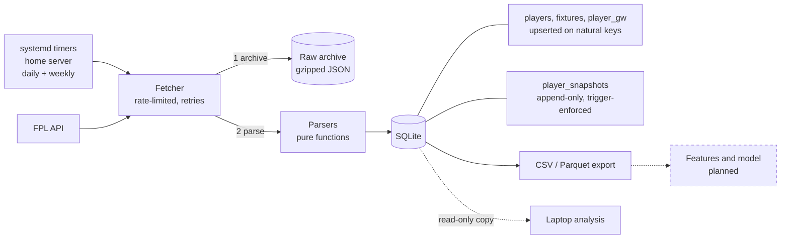

# real_fpl

A data pipeline for Fantasy Premier League. It collects player data from public APIs every day
and stores it so a model can later suggest which players to buy and sell.

Status: the ingestion pipeline is built and running daily. Feature engineering and the model
come next.

## What it does

- Pulls player, fixture and per-match data (xG, xA, minutes, cards, bonus, price) from the FPL API.
- Takes a **daily snapshot** of price, ownership and injury state. The API only shows these
  *as of now*, so a day that isn't captured can never be recovered.
- Stores everything in SQLite and exports to CSV or Parquet for analysis.

At the time of writing it holds 674 players and about 7,200 player-match rows.



The archive step comes before parsing on purpose: the raw response is saved first, so a parser
bug is fixed by re-parsing, not re-fetching.

## Design decisions

The three that matter, and why:

1. **Join on `opta_code`, never on names.** 17 surnames in the player list are duplicated, so a
   name join silently produces wrong rows. Opta IDs are identical across both sources
   (checked on 656 of 656 players) and stable between seasons, unlike FPL's own ids.
2. **Archive raw responses before parsing.** Every API response is gzipped to disk first. A parser
   bug then costs a re-parse, not a re-fetch of data that has since changed.
3. **`player_snapshots` is append-only**, enforced by SQLite triggers that reject `UPDATE` and
   `DELETE`. Training on end-of-season prices to predict that season's points leaks the future
   into the features, so the history has to be kept as it was seen.

Other conventions: settled facts are upserted on natural keys, so every command is safe to re-run;
endpoints and rate limits live in `config/sources.yaml`; transforms are pure functions from JSON
to rows and are tested against committed samples, never the live API.

## Running it

Requires [uv](https://docs.astral.sh/uv/).

```bash
uv sync
uv run real-fpl init-db                    # create the schema
uv run real-fpl fetch-fpl --snapshot       # one request: price + injury state now
uv run real-fpl fetch-fpl --all            # + fixtures + every player's match history (~6 min)
uv run real-fpl fetch-historical           # one-off: 2024-25, 2025-26 from the FPL mirror
uv run real-fpl export                     # CSV / Parquet out
uv run real-fpl status                     # row counts and last-fetch times
uv run pytest
```

## Daily run on a home server

A Debian machine at home is the only place that fetches. Two systemd user timers run the same
CLI:

| Timer | Command | When |
|---|---|---|
| `real-fpl-snapshot` | `fetch-fpl --snapshot` | daily, 08:00 |
| `real-fpl-full` | `fetch-fpl --all` | Mondays, 08:30 |

- With `REAL_FPL_ENTRY_ID` set (server only), the snapshot run also fetches that FPL team's
  gameweek history and any new gameweek's picks, about 2 requests a day.
- Snapshots are the time-sensitive part (see above); the weekly full fetch only refreshes
  history that can always be re-downloaded.
- Timers use `Persistent=true`, so a run missed while the machine was off happens on next boot.
  A catch-up run records the state at that moment; it cannot recover the missed day.
- Single ingester by design: a second machine fetching would fork `player_snapshots`. Other
  machines pull a read-only copy instead of fetching:

  ```bash
  export REAL_FPL_REMOTE_DB="user@server:repo/real_fpl/data/fpl.db"   # once, e.g. in ~/.bashrc
  scripts/pull-db.sh
  ```

  It uses `sqlite3_rsync` (SQLite >= 3.47, needed on both machines), which is safe while a
  fetch is writing and only transfers changed pages. Plain `scp` of `fpl.db` is not safe: the
  database uses WAL mode, so recent writes may still be in `fpl.db-wal`.

## Data sources

Both are public JSON with no browser or HTML parsing needed:

- **FPL API** (`fantasy.premierleague.com/api`): the backbone.
- **Premier League API** (`footballapi.pulselive.com`): the official Opta feed. The source
  module is not built yet.

FBref, Understat, FotMob and WhoScored were checked and deliberately left out (bot protection,
client-rendered pages, or `robots.txt` disallowing it).

## Layout

```
config/sources.yaml     endpoints, season ids, rate limits
src/real_fpl/
  http.py               rate-limited session, retries, raw-response archiving
  db.py                 schema and upsert/append helpers
  sources/              one module per upstream source
  transform/            raw JSON -> table rows (pure functions)
  export.py             CSV / Parquet and the enriched player-match view
scripts/pull-db.sh      copy the server's database to this machine (see above)
tests/                  run against committed samples in tests/fixtures/
data/                   database, raw archive, exports (gitignored, reproducible)
```

## Next

- Features for a 3-gameweek points target (in progress): history for 2024-25 and 2025-26 is
  backfilled (`real-fpl fetch-historical`); next is the target table and lagged features.
- Later: rest and rotation (needs European and cup fixtures), a date dimension.
- A model: baselines, then a GLM, then gradient-boosted trees, tested on a season-based split.
  Buy and sell suggestions come after that.

## Web UI

A small read-only website over the database: a filterable player table, a page per player
(match history, points and price charts, any past season) and a fixture-difficulty grid.

```bash
uv run real-fpl serve                 # http://localhost:8000
uv run real-fpl serve --reload        # restart on code changes while developing
REAL_FPL_DB=/path/to/fpl.db uv run real-fpl serve   # use a database somewhere else
```

It is FastAPI rendering Jinja2 HTML templates, with htmx for in-place filtering and Chart.js for
the charts (both vendored in `src/real_fpl/web/static/`, so no Node and no CDN). The database is
opened with SQLite's `mode=ro`, so the site cannot write to it. It listens on 127.0.0.1 only and
has no login.
